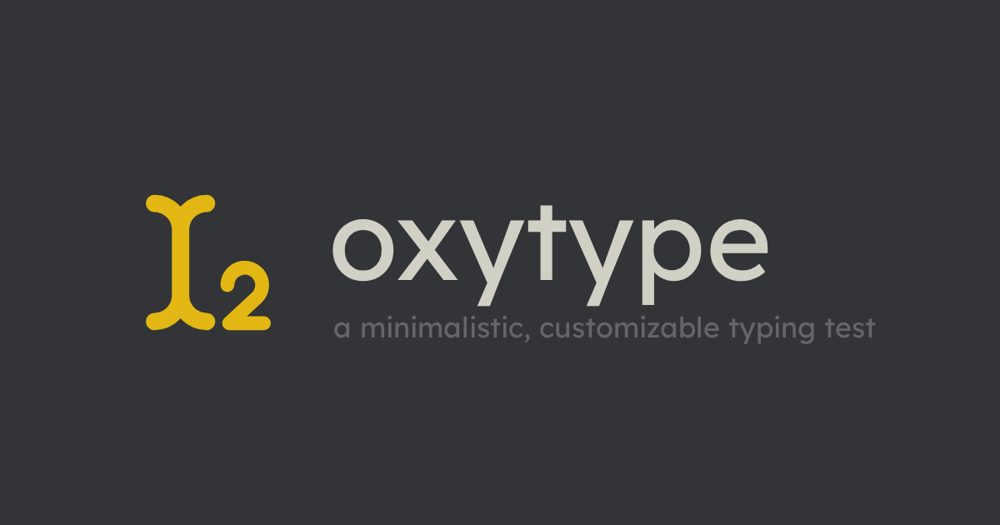

<p align="center">
  
</p>

# Oxytype

Oxytype is an independent, open-source typing test. It offers multiple test modes, languages, themes, live speed and accuracy feedback, and account-based result history.

This project began from the Monkeytype codebase and now has its own roadmap. We retain the original contributors' work and attribution in the Git history. Oxytype is licensed under [GPL-3.0](./LICENSE).

Oxytype does not support self-hosting. For self-hosting, use [Monkeytype](https://github.com/monkeytypegame/monkeytype).

## Development

Use Node 24.22.1 and [Vite+](https://viteplus.dev/guide/) (`vp`) for every command; pnpm 12.15.0 is the package manager under the hood. Follow [the development setup guide](./docs/CONTRIBUTING_ADVANCED.md) for Better Auth and backend configuration. See [the architecture overview](./docs/ARCHITECTURE.md) for the codebase and stack.

```sh
vp install
vp exec cp frontend/.dev.vars.example frontend/.dev.vars
vp run --filter @caret/frontend db:migrate
vp run dev
```

The TanStack Start app, its API and local D1 run at `http://localhost:3000`.

Typing rules run in the platform-independent [Rust engine](./crates/typing-engine).
The website loads its [Wasm SDK](./packages/typing-engine/README.md) only in the
browser; Cloudflare continues serving SSR, auth and APIs. Install the toolchain
pinned in `rust-toolchain.toml` with its Wasm target. Build bootstrap generates the
bindings automatically; `vp run engine:parity` checks native and built-browser
behavior against immutable original references. `vp run engine:lint` and
`vp run engine:fmt` check Rust. Measured budgets are in
[performance budgets](./docs/rust-engine/performance-budgets.md).

## Offline terminal

The native [Ratatui app](./docs/rust-engine/terminal.md) uses the same engine
on Linux/macOS without Wasm. It includes English words/quotes, five typing modes, settings,
durable local history and JSON export. No account, sync or first-run download.
`vp run terminal:dev` runs it; `vp run terminal:test` and
`vp run terminal:test:pty` check native behavior and terminal lifecycle.
`vp run terminal:test:emulator -- --emulator kitty --command /usr/bin/kitty`
checks actual Kitty keyboard input in a private Linux display; Ghostty and
Alacritty are also supported by the harness. See the terminal docs for tools.
`vp run terminal:package` prepares a licensed binary archive. Installed users
need no development runtime. See [release verification/status](./docs/rust-engine/terminal-release.md)
for tested platforms and pending real-terminal checks; no release published yet.

## Contributing

See [CONTRIBUTING.md](./docs/CONTRIBUTING.md) and the [code of conduct](./docs/CODE_OF_CONDUCT.md). Report bugs in the [Oxytype repository](https://github.com/voltcrash/caret/issues).

## Contact and security

Public site: [caret.voltcrash.com](https://caret.voltcrash.com). Maintainers use [production operations](./docs/PRODUCTION_SETUP.md) for the official site's deployment and updates.

Use [GitHub discussions](https://github.com/voltcrash/caret/discussions) for general questions and feature ideas, and [the security policy](./docs/SECURITY.md) for private vulnerability reports.
