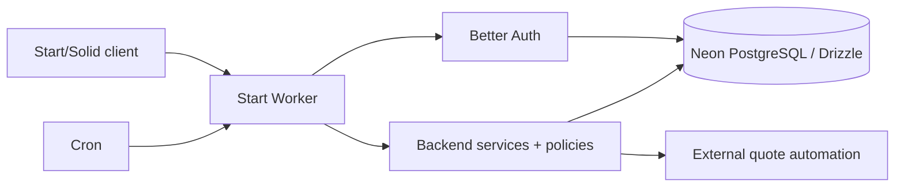

# Caret architecture

Package versions come from the workspace manifests and lockfile.

## Repository map

| Path | Role |
| --- | --- |
| `frontend/` | TanStack Start application and Worker, static assets, Storybook, web tests |
| `backend/` | Server-only services, policies, jobs, persistence, migrations, backend tests |
| `packages/contracts/` | Retained external HTTP API contracts |
| `packages/schemas/` | Shared Zod schemas and domain types |
| `packages/util/`, `packages/funbox/`, `packages/challenges/` | Shared helpers and typing features |
| `crates/typing-engine/` | Platform-independent typing rules, generation, scoring and replay |
| `crates/typing-engine-wasm/`, `packages/typing-engine/` | Browser-only Wasm boundary, generated types and owned handles |
| `packages/typing-fixtures/` | Immutable original behavior references and capture provenance |
| `packages/web-shared/` | SSR-safe preferences, browser wire types, transport and display helpers |
| `packages/oxlint-config/`, `packages/typescript-config/` | Shared tooling configuration |
| `packages/release/` | Production CI validation helpers |
| `.github/workflows/` | [CI](CI.md), automatic production deployments after successful main CI, manual retries, labeling, and repository automation |

The root is a private pnpm workspace. Vite+ (`vp run`) runs workspace tasks.
TypeScript packages use the `@caret` scope and export source. Vite, Vitest,
wrangler and `vpx` compile it. Rust/Wasm and declarations build automatically before
development, production, tests and typechecks; see the [engine SDK](../packages/typing-engine/README.md).

## Application

TanStack Start (SolidJS) is the application framework and deployment owner of
`frontend/`. One Cloudflare Worker (`frontend/src/worker.ts`) serves the origin:
`fetch` runs Start (document SSR, routes, server functions, `/api` server
routes); `scheduled` runs backend maintenance. Each invocation runs inside
`withRuntime(env, …, ctx)`. See the [migration index](tanstack-start/README.md)
for the operation inventory, remaining compatibility rules and archived evidence.

| Path | Role |
| --- | --- |
| `frontend/src/routes/` | File routes: `__root` document, `_app` layout, pages, `/api` server routes |
| `frontend/src/app/` | Document, providers, application owner, browser runtime, navigation |
| `frontend/src/features/` | Route-level product features (typing, account, settings, …) |
| `frontend/src/functions/`, `src/server/` | Server functions and server-only policy adapters |
| `frontend/src/data/` | Query options and browser operation client |
| `frontend/src/ts/` | Shared UI components, state, typing runtime helpers |
| `frontend/src/sw/` | Service worker generated per build |
| `backend/src/` | Services, policies, DAL, Drizzle/Neon PostgreSQL, Better Auth, jobs (server-only package) |

Rendering: SSR renders the document, shared layout and public content; the
typing engine and browser integrations mount as client-only leaves
(`*.client.*`). Start import protection keeps `backend/src` and `*.server.*`
out of client bundles and browser state (`src/ts/**`) out of SSR.

Navigation: TanStack Router owns routes, search params, loaders, links, intent
preloading and history. Internal anchors use `Link` (or `Button` with
`router-link`); the layout's `LinkHost` renders Router links. Imperative callers
use `app/navigate.ts` (`navigate`, `replaceUrl`). The typing guard
(`app/navigation-guard.client.ts`) blocks navigation while a result calculates
or a test restarts; `force` skips those checks but never an active `no_quit`
test.

Data: first-party reads/mutations are server functions; Query owns remote data,
DB collections own browser history. App state lives under one mounted
application owner (`app/application.ts`); account-scoped state resets on actor
change. Never keep module-level mutable state.

Tailwind CSS supplies utilities and theme colors; compatibility CSS keeps
theme/funbox selectors. Icons use `Fa`. `AnimatedModal` uses `hidden open:flex`:
never add `hidden` imperatively, or a closed dialog can intercept clicks.

## Backend and data

`@caret/backend` exports narrow server-only subpaths (runtime, services,
policies, auth, http, jobs). Start handlers call services directly; there is no
internal HTTP hop. Shared ts-rest contracts and Zod schemas define the retained
external HTTP API. Drizzle describes Neon PostgreSQL tables; Better Auth uses database-backed
sessions for Google/GitHub accounts. Private operations require a session cookie
or Bearer session token. External API keys are unsupported.

Neon PostgreSQL owns data, result progression and rankings. User JSON writes use
optimistic version guards inside atomic batches. Cron refreshes rankings and
purges expired records. Structured logs carry the build ID and feed Workers
observability; server errors never write to Neon PostgreSQL. Each request also writes one
Analytics Engine data point (`METRICS`).

Hot paths avoid Neon PostgreSQL where staleness is bounded:

- Rate limits: Workers rate limiting bindings, per location and approximate
  (`policies/rate-counter.ts`). Bad-authentication points: Cache API.
- Configuration: cached per isolate for 30s (`init/configuration.ts`).
- Cookie sessions: Better Auth's signed cookie cache, at most 60s old.
  Admin, fresh-token, auth-handler, UI-session and Bearer lookups read Neon PostgreSQL.
- Public reads: operations in `policies/edge-cache.ts` are stored in the
  location's Cache API for 30–300s. SSR documents stay `no-store`.

Each invocation owns a lazy Neon HTTP client shared by Drizzle and raw queries.
Reads use the primary. User writes lock a versioned user row and assert its
version inside a PostgreSQL transaction. Durable receipts recover lost commit
acknowledgements without duplicate progression. Cron expires receipts after
seven days. Production keeps Smart Placement. Database monitoring uses Neon.

## Development and delivery

`vp run dev` starts Start on port 3000 with local workerd and a development Neon branch
(`vp run --filter @caret/frontend db:migrate` first). Vitest covers web
units, Start SSR/workerd suites, backend services and real Neon PostgreSQL behaviour;
Playwright covers the built Start Worker.

`frontend/wrangler.staging.json` and `wrangler.production.json` own deployment
with isolated Neon PostgreSQL, OAuth and Turnstile credentials. Migrations read
DATABASE_URL from the corresponding private frontend/.dev.vars file. See [production setup](PRODUCTION_SETUP.md),
[staging setup](STAGING_SETUP.md) and [operations](CLOUDFLARE_OPERATIONS.md).
Built-in [anticheat](ANTICHEAT.md) checks scores and telemetry in all modes.

## Caret ownership boundaries

The fork uses its own production auth secret, GitHub OAuth app, Turnstile widget
and API endpoint at [caret.voltcrash.com](https://caret.voltcrash.com). Other
optional integrations need deployment-owned credentials before enabling them.
Public contact and security reporting use the Caret repository and its security
policy. The
original GPL license and contributor attribution remain in place.

See [development setup](CONTRIBUTING_ADVANCED.md) and [security reporting](SECURITY.md) for operational details.
