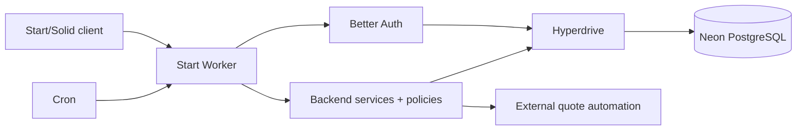

# Caret architecture

Package versions come from the workspace manifests and lockfile.

## Repository map

| Path | Role |
| --- | --- |
| `frontend/` | TanStack Start application and Worker, static assets, Storybook, web tests |
| `backend/` | Server-only services, policies, jobs, persistence, migrations, backend tests |
| `packages/contracts/` | Retained external HTTP API contracts |
| `packages/schemas/` | Shared Zod schemas and domain types |
| `packages/util/`, `packages/funbox/`, `packages/challenges/` | Shared helpers and typing features |
| `crates/typing-engine/` | Platform-independent typing rules, generation, scoring and replay |
| `crates/typing-engine-wasm/`, `packages/typing-engine/` | Browser-only Wasm boundary, generated types and owned handles |
| `packages/typing-fixtures/` | Immutable original behavior references and capture provenance |
| `packages/web-shared/` | SSR-safe preferences, browser wire types, transport and display helpers |
| `packages/oxlint-config/`, `packages/typescript-config/` | Shared tooling configuration |
| `packages/release/` | Production CI validation helpers |
| `.github/workflows/` | [CI](CI.md), automatic production deployments after successful main CI, manual retries, labeling, and repository automation |

The root is a private pnpm workspace. Vite+ (`vp run`) runs workspace tasks.
TypeScript packages use the `@caret` scope and export source. Vite, Vitest,
wrangler and `vpx` compile it. Rust/Wasm and declarations build automatically before
development, production, tests and typechecks; see the [engine SDK](../packages/typing-engine/README.md).

## Application

TanStack Start (SolidJS) is the application framework and deployment owner of
`frontend/`. One Cloudflare Worker (`frontend/src/worker.ts`) serves the origin:
`fetch` runs Start (document SSR, routes, server functions, `/api` server
routes); `scheduled` runs backend maintenance. Each invocation runs inside
`withRuntime(env, …, ctx)`. See the [migration index](tanstack-start/README.md)
for the operation inventory, remaining compatibility rules and archived evidence.

| Path | Role |
| --- | --- |
| `frontend/src/routes/` | File routes: `__root` document, `_app` layout, pages, `/api` server routes |
| `frontend/src/app/` | Document, providers, application owner, browser runtime, navigation, modal host and dev tools |
| `frontend/src/features/` | Route-level product features (typing, account, settings, …), each owning its components, state and hooks |
| `frontend/src/functions/`, `src/server/` | Server functions and server-only policy adapters |
| `frontend/src/data/` | Operation client (`operations.ts`), browser query helpers (`queries/`) and IndexedDB collections (`collections/`); feature-specific query options live in the feature (`features/*/queries.ts`) |
| `frontend/src/ts/` | Shared UI kit, app-wide state, browser engine wrappers (`engine/`), commandline and utilities; no new feature imports (see below) |
| `frontend/src/sw/` | Service worker generated per build |
| `backend/src/` | Services, policies, DAL, Drizzle/Neon PostgreSQL, Better Auth, jobs (server-only package) |

Code used by one feature lives in that feature. Shared code in `src/ts` and
`src/data` must not import features; `__tests__/architecture/feature-boundaries.spec.ts` enforces this boundary. Code outside typing may only import the typing
modules in `typing-public-surface.json`, which also only shrinks. Shared code
triggers typing (restart, blur, hints, pace caret) and reads route activity
through `src/ts/typing-host.ts`, which the typing route binds while mounted.

Typing feature (`frontend/src/features/typing/`):

| Path | Role |
| --- | --- |
| `page*.tsx`, `runtime.client.tsx` | Route page and client-only typing leaf |
| `initial/` | SSR initial content, snapshot and first-paint view |
| `lifecycle/` | Route enter/exit, lifecycle controller and state machine |
| `history/` | Result outbox, guest scores and practice history |
| `keymap/` | Keymap layouts and conversion |
| `commands/`, `host.client.ts` | Palette command contributions; the typing host the route binds while mounted |
| `components/` | Test page, words renderer, result screen and live stats |
| `input/` | Keystroke, composition and input listeners and handlers |
| `state/` | Typing-only app state (result, layout, modifiers, quote rating) |
| `modals/` | Typing modals (custom text, quotes, practice, event log viewer, dev options) |
| `runtime/test/` | Test logic, timer, words and UI facade |
| `runtime/content/`, `runtime/completion/`, `runtime/result/` | Content loading, test completion, result screen and saving |
| `runtime/events/`, `runtime/funbox/` | Session events and funbox behaviour |

Rendering: SSR renders the document, shared layout and public content; the
typing engine and browser integrations mount as client-only leaves
(`*.client.*`). Start import protection keeps `backend/src` and `*.server.*`
out of client bundles and browser state (`src/ts/**`) out of SSR.

Navigation: TanStack Router owns routes, search params, loaders, links, intent
preloading and history. Internal anchors use `Link` (or `Button` with
`router-link`); the layout's `LinkHost` renders Router links. Imperative callers
use `app/navigate.ts` (`navigate`, `replaceUrl`). The typing guard
(`app/navigation-guard.client.ts`) blocks navigation while a result calculates
or a test restarts; `force` skips those checks but never an active `no_quit`
test.

Operations: a contract (`packages/contracts`) and its service
(`backend/src/services/operations/registry.ts`) define each operation.
`frontend/scripts/generate-operations.ts` writes the `/api` route files from the
contracts and one narrow server function per ID listed in
`frontend/src/functions/operations/web-operations.ts`; CI checks both are
current. Never edit the generated files by hand.

Data: first-party reads/mutations are server functions; Query owns remote data,
DB collections own browser history. App state lives under one mounted
application owner (`app/application.ts`); account-scoped state resets on actor
change. Never keep module-level mutable state: use `createAppOwned`,
`createAppSignal`/`createAppStore`, or `createBinding` (`app/binding.ts`) for a
handle a mounted component publishes. `caret-rules/no-module-let` rejects
top-level `let`; document-scoped exceptions carry a suppression reason.

Preferences: one Solid store (`src/ts/config/store.ts`) holds the configuration.
`getConfig` reads it reactively; `peekConfig` returns the same object untracked
and read-only for hot paths. Only the setters write, inside a batch: change
listeners (`configEvent`) see the new value first, then reactive readers update.

Events: `createEvent` buses are for changes with several independent
listeners (config changes, result highlighting, OAuth requests). Their
listeners are app-owned. A one-listener notification is a direct call, a
binding, or a typing host action instead.

Command palette: `src/ts/commandline` owns the palette and core commands.
Features add commands at named slots through `registry.ts` while the palette is
mounted (`app/commandline.client.tsx`); shared commands reach typing only
through `typing-host.ts`.

Tailwind CSS supplies utilities and theme colors; compatibility CSS keeps
theme/funbox selectors. Icons use `Fa`. `AnimatedModal` uses `hidden open:flex`:
never add `hidden` imperatively, or a closed dialog can intercept clicks.

## State transitions

| Owner | States and transition rules |
| --- | --- |
| Rust typing session | Ready → running → finish pending → ended. Immediate completion skips the acknowledgement. Reset returns to ready. The start time, finish request and failure reason belong to their respective states. |
| Session content | Available, waiting for a checkpoint, or awaiting recovery. A matching source reply resumes the checkpoint. Failure discards it. Content and timing can wait independently. |
| Content preparation | New, released, or prepared. Preparing owns a generator and optional generated preview. Starting a session transfers the generator. Recycling retains learning for the next generation. Batch generation can suspend for content or fail until reset. |
| Arrow funbox | Left and right feet alternate after each generated step. The first arrow chooses the starting foot. |
| Web typing route | The route machine owns preparation, running, completion, result and error phases. A mounted page accepts URL settings after entry. A pending browser completion owns its acknowledgement clock. The initial preview seed is consumed once. |
| Browser engine and audit | The loading state owns the shared initialization promise. Success publishes the API. Failed downloads can retry. Engine disposal aborts session leases. |
| Terminal results | A finished session has one summary or one summary error. A captured record guards duplicate capture while the disk write queue retries independently. |
| Startup, auth and verification | Readiness shares one startup task and releases waiters on success, error or disposal. Session observation distinguishes first load, guest and signed-in users. CAPTCHA verification can expire, fail or be consumed. |
| Persistence | Actor caches move from idle through restoration to a subscribed ready state. Clear invalidates restoration and disposal releases the subscription. The result outbox shares its first read and returns to idle on failure. Lazy mode preferences distinguish unread and stored values. |
| Database writes | An acknowledged batch supplies statement results. Recovery by receipt confirms the commit and callers read any missing results separately. |
| Modal and command palette | A closing modal owns its queued successor. Only the matching close acknowledgement releases it. A mobile sheet tracks a drag, retains its release offset during dismissal, then resets. The palette accepts input until closing starts. |
| Settings and challenges | The importer accepts one file read or one import at a time. A new modal opening invalidates earlier work. Challenge setup owns a request identity so only the current setup can clear its loading state. |
| Connection and updates | An offline banner is eligible, visible or dismissed until reconnection. Service worker takeover may be silent or request a reload. A requested update owns its fallback timer until takeover, timeout or disposal. |
| Audio | A loading sample can queue playback. A ready sample owns the decoded buffer. Failed and disposed samples stay silent. Only a playing voice owns a buffer source. |
| Result and overlay views | Word highlighting measures before painting and invalidates old measurements on history changes. XP breakdowns progress through display, skip or hold, and hide. Timeline playback and the FPS counter own frames only while running. Tooltip focus cancels pending pointer dismissal. Theme previews coalesce on a frame and remember whether dismissal must restore an applied preview. |

## Backend and data

`@caret/backend` exports narrow server-only subpaths (runtime, services,
policies, auth, http, jobs). Start handlers call services directly; there is no
internal HTTP hop. Owned route contracts and Zod schemas define the retained
external HTTP API. Drizzle describes Neon PostgreSQL tables; Better Auth uses database-backed
sessions for Google/GitHub accounts. Private operations require a session cookie
or Bearer session token. External API keys are unsupported.

Neon PostgreSQL owns data, result progression and rankings. User JSON writes use
optimistic version guards inside atomic batches. Cron refreshes rankings and
purges expired records. Structured logs carry the build ID and feed Workers
observability; server errors never write to Neon PostgreSQL. Each request also writes one
Analytics Engine data point (`METRICS`).

Hot paths avoid Neon PostgreSQL where staleness is bounded:

- Rate limits: Workers rate limiting bindings, per location and approximate
  (`policies/rate-counter.ts`). Bad-authentication points: Cache API.
- Configuration: cached per isolate for 30s (`init/configuration.ts`).
- Cookie sessions: Better Auth's encrypted (JWE) cookie cache, at most 60s old.
  Admin, fresh-token, auth-handler, UI-session and Bearer lookups read Neon PostgreSQL.
- Public reads: operations in `policies/edge-cache.ts` are stored in the
  location's Cache API for 30–300s. SSR documents stay `no-store`.

Each invocation owns a lazy `pg` pool over Cloudflare Hyperdrive (TCP), shared by
Drizzle and raw queries and closed when its work completes.
Reads use the primary. User writes lock a versioned user row and assert its
version inside a PostgreSQL transaction. Durable receipts recover lost commit
acknowledgements without duplicate progression. Cron expires receipts after
seven days. Production keeps Smart Placement. Database monitoring uses Neon.

## Development and delivery

`vp run dev` starts Start on port 3000 with local workerd and a development Neon branch
(`vp run --filter @caret/frontend db:migrate` first). Vitest covers web
units, Start SSR/workerd suites, backend services and PostgreSQL behaviour in PGlite;
Playwright covers the built Start Worker.

`frontend/wrangler.staging.json` and `wrangler.production.json` own deployment
with isolated Neon PostgreSQL, OAuth and Turnstile credentials. Migrations read
DATABASE_URL from the corresponding private frontend/.dev.vars file. See [production setup](PRODUCTION_SETUP.md),
[staging setup](STAGING_SETUP.md) and [operations](CLOUDFLARE_OPERATIONS.md).
Built-in [anticheat](ANTICHEAT.md) checks scores and telemetry in all modes.

## Caret ownership boundaries

The fork uses its own production auth secret, GitHub OAuth app, Turnstile widget
and API endpoint at [caret.voltcrash.com](https://caret.voltcrash.com). Other
optional integrations need deployment-owned credentials before enabling them.
Public contact and security reporting use the Caret repository and its security
policy. The
original GPL license and contributor attribution remain in place.

See [development setup](CONTRIBUTING_ADVANCED.md) and [security reporting](SECURITY.md) for operational details.
